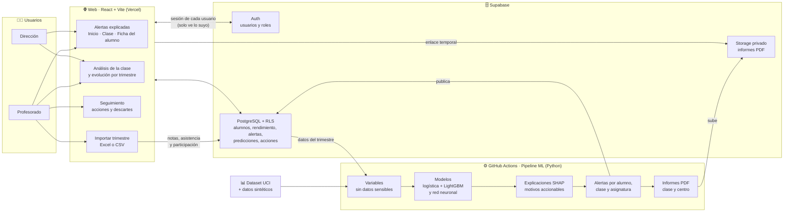

# Brújula

**Alertas tempranas y explicables para que el profesorado sepa a tiempo qué alumnos podrían necesitar apoyo.**

\#hack4edu 2026 · Reto 13 «La escuela que aprende de sus datos» · Modalidad innovadora y Premio Retos ProFuturo

Al acabar cada trimestre, el profesorado sube las notas, la asistencia y la participación de su clase. Brújula avisa de qué alumnos podrían necesitar apoyo para aprobar **y explica por qué**, por ejemplo con «nota del primer periodo: 4,5» o «asistencia: 68 %». También estima la nota final de cada alumno, propone por dónde empezar y comprueba al cerrar el curso si los avisos acertaron. La decisión siempre es del profesor: Brújula avisa y explica, no etiqueta.

---

## Probarla sin instalar nada

**👉 https://brujula-nu-one.vercel.app**

La contraseña es la misma para todos los usuarios: **`Brujula-2026!`**

| Correo | Qué ve |
| --- | --- |
| `profesor.gp@example.com` | Profesor de Portugués · Escuela GP |
| `profesor.ms@example.com` | Profesor de Matemáticas · Escuela MS |
| `director.gp@example.com` | Director · Escuela GP |
| `director.ms@example.com` | Director · Escuela MS |

Todos los alumnos y nombres son ficticios. La web está en **español, portugués, inglés y francés** (selector 🌐). Los informes PDF están en español.

## Probarla en tu ordenador (5 minutos)

Solo hace falta **[Node.js](https://nodejs.org) 22 o superior** (la versión LTS). La base de datos ya está en la nube con los datos de la demo.

```bash
cd brujula/frontend
cp .env.example .env        # en Windows (cmd): copy .env.example .env
npm install
npm run dev
```

Abre **http://localhost:5173** en el navegador. La clave de `.env.example` es la **pública** de Supabase: está pensada para estar a la vista, porque los datos los protegen las reglas de seguridad de la base de datos.

---

## Recorrido recomendado (10 minutos)

**Como profesor** (`profesor.gp@example.com`):

1. **Inicio.** Las alertas más importantes, agrupadas por motivo, y el botón **Próximas revisiones**.
2. **Portugués → 4.º Primaria C.** La lista de alumnos con sus notas y sus alertas. Cada alerta dice **por qué** ha saltado. Debajo, **cómo ha evolucionado la clase** y **si acertaron los avisos** del primer trimestre.
3. **Pulsa en un alumno.** Su ficha: cómo va frente a la media de la clase, su nota final estimada con un margen, sus alertas, su contexto y las acciones registradas.
4. **En una alerta, «Registrar acción»** (por ejemplo, una tutoría) **o «Descartar con motivo».** El profesor revisa y decide.
5. **Próximas revisiones.** El seguimiento de las acciones (en seguimiento o resueltas) y de los descartes.
6. **«Análisis completo de la clase».** Qué variables pesan más en las alertas de esa clase, la nota estimada media y los alumnos que podrían necesitar apoyo.
7. **«Descargar informe (PDF)».** El informe de la clase, con **por dónde empezar** y **qué vigilar**.
8. **Importar un trimestre.** En **6.º Primaria G**, en el apartado de datos de un trimestre, elige el **3.º trimestre**, pulsa **Importar Excel** y selecciona [`docs/demo/6G-portugues-trimestre3.csv`](docs/demo/6G-portugues-trimestre3.csv) (acepta Excel y CSV). Brújula revisa los datos antes de guardarlos; al guardar aparecen alertas nuevas y se actualiza la evolución. También hay un archivo del [2.º trimestre](docs/demo/6G-portugues-trimestre2.csv).

**Como director** (`director.gp@example.com`):

9. **Inicio del director.** La visión del centro: alumnos con alerta, prioridad alta, acciones del profesorado, asignaturas y clases, con **filtros por curso y prioridad**.
10. **«Informe del centro (PDF)».** Dónde poner el foco y cómo va el seguimiento del profesorado.

**Sin iniciar sesión:** la portada y las páginas «El modelo», «Pocos recursos» y «Cómo llega» explican el proyecto a cualquier visitante.

---

## Resultados del modelo

Evaluado con validación cruzada por alumno (un mismo alumno nunca está a la vez en entrenamiento y en validación), con los alumnos reales de Portugués y Matemáticas.

| | Brújula | Regla «suspende el 1.er trimestre» |
| --- | --- | --- |
| Alumnos que necesitarán apoyo detectados | **84 %** | 84 % |
| Avisos acertados | **70 %** | 64 % |
| Falsas alarmas | **23 menos** | — |
| Alumnos que aprueban el 1.er trimestre y aun así necesitarán apoyo | **14 detectados** | 0 |

- **Alertas:** combinación de regresión logística y LightGBM, elegida entre **7 combinaciones** de modelos por ser la que da menos falsas alarmas.
- **Nota final estimada:** red neuronal multitarea en PyTorch, con un error medio de unos **0,5 puntos sobre 10** y un intervalo que acierta el 80 % de las veces (MC Dropout).
- **Explicaciones:** SHAP, mostrando solo motivos accionables y coherentes. No se muestran como motivo la asignatura ni las variables de apoyo, que tienen causalidad inversa.
- **Comprobación al cerrar el curso:** de los alumnos avisados en el 1.er trimestre, 7 de cada 10 acabaron necesitando apoyo, y más de 8 de cada 10 de los que lo necesitaron fueron avisados a tiempo. Las alertas publicadas son **fuera de muestra**: cada alumno se predice con un modelo que no lo vio al entrenar.
- **Sin los datos sintéticos** el resultado se mantiene: 14 falsas alarmas menos que la regla.

Todo el detalle, incluida la equidad por sexo, zona y escuela, está en la **[ficha del modelo](docs/ficha-del-modelo.md)**.

## Ética y privacidad

- **No se muestra nunca** una probabilidad ni una «puntuación de riesgo» de un alumno, ni rankings de alumnos.
- **No se usan como entrada** datos de salud, ocio, alcohol, relaciones o situación familiar, ni el trabajo de los padres. Sexo, zona y escuela solo se usan para **auditar** la equidad del modelo.
- **Cada profesor solo ve a sus alumnos y cada director solo su centro,** y eso lo garantizan las reglas de seguridad de la base de datos (RLS), no solo la web. Los grupos de menos de 5 alumnos no se muestran.
- **Ninguna alerta decide nada:** el profesor la revisa, registra una acción o la descarta con un motivo, y todo queda auditado.
- **Diferencia conocida:** el modelo detecta por igual a todos los grupos, pero da más falsas alarmas en zona rural (15 % frente a 8 %). Se muestra con transparencia en la web y en la ficha del modelo.

---

## Cómo funciona por dentro

```
Profesorado            Supabase              GitHub Actions (Python)                 Web y PDF
sube el trimestre  →   PostgreSQL + RLS  →   variables → modelos → SHAP → alertas →  alertas explicadas,
(Excel o CSV)          (datos y permisos)    (≈ 5 minutos, con un clic)              ficha, informes
```

1. **Datos.** El dataset público [Student Performance de la UCI](https://archive.ics.uci.edu/dataset/320/student+performance) (CC BY 4.0), con 674 alumnos reales y anónimos de dos institutos portugueses, ampliado con datos sintéticos de clases, profesores, Inglés, Ciencias, prácticas, participación y asistencia. Las variables sintéticas se marcan con un asterisco (\*). Detalle en [datos.md](docs/datos.md).
2. **Modelo.** La Action **Pipeline ML** prepara las variables, entrena y compara los modelos, calcula las explicaciones SHAP, genera las alertas por alumno, clase y asignatura, las publica en Supabase y genera los informes PDF.
3. **Web.** React + Vite, desplegada en Vercel. Lee los datos de Supabase con la sesión de cada usuario.
4. **Escala.** El dataset original va sobre 20; la web y los informes muestran las notas **sobre 10**.

| Carpeta | Contenido |
| --- | --- |
| [`frontend/`](frontend/) | Web en React + Vite. **Es lo único que hay que ejecutar para probar la demo.** |
| [`ml/`](ml/) | Variables, modelos de referencia, red neuronal, combinaciones, SHAP, alertas y publicación (Python). |
| [`data/`](data/) | Preparación del dataset de la UCI y generación de los datos sintéticos. |
| [`reports/`](reports/) | Generación de los informes PDF de clase y de centro. |
| [`supabase/`](supabase/) | Base de datos: tablas, reglas de seguridad (RLS), vistas y pruebas. |
| [`docs/`](docs/) | Ficha del modelo, datos, diagramas, wireframes, guía de estilo y archivos de demo. |
| [`.github/workflows/`](.github/workflows/) | La Action que ejecuta todo el proceso de datos, modelo, alertas e informes. |

**Tecnologías (todas gratuitas):** React, TypeScript, Tailwind, Recharts, Supabase (PostgreSQL), Python (pandas, scikit-learn, LightGBM, PyTorch, SHAP), WeasyPrint, GitHub Actions y Vercel.

### Reproducir el modelo

Con Python 3.12, desde la raíz del repositorio:

```bash
pip install torch --index-url https://download.pytorch.org/whl/cpu
pip install -r ml/requirements-ci.txt
python data/prepare_uci.py && python data/extend.py
cd ml
python features.py && python baselines.py && python model.py
python combinar.py && python explain.py && python alerts.py
```

Todo usa semilla fija. Para publicar en Supabase (`python publish.py`) hace falta la clave secreta del proyecto en `ml/.env`, que no está en el repositorio.

---

## Limitaciones

- Los datos reales son de hace unos 20 años y de dos institutos portugueses: antes de usar Brújula en una escuela real habría que reentrenarla con sus propios datos.
- Prácticas, participación, asistencia por trimestre, Inglés y Ciencias son **sintéticas**, generadas a partir de las notas reales. Su peso en las explicaciones refleja cómo se generaron, no un hallazgo.
- La nota del primer trimestre es el predictor más fuerte: Brújula complementa el criterio del profesor, no lo sustituye.

## Si algo falla

| Problema | Solución |
| --- | --- |
| `npm: command not found` | Instala [Node.js](https://nodejs.org) (LTS) y abre una terminal nueva. |
| La página sale en blanco | Falta el archivo `frontend/.env`. Repite el paso `cp .env.example .env`. |
| El puerto 5173 está ocupado | Vite usará otro (5174, 5175…). Mira la URL que aparece en la terminal. |
| No puedo entrar | Revisa la contraseña: `Brujula-2026!`, con mayúscula y exclamación. |
| No carga ningún dato | El plan gratuito de Supabase pausa los proyectos tras una semana sin uso. Escríbenos y lo reactivamos. |

## Equipo

Brújula ha sido creada por:

| Nombre | Papel |
| --- | --- |
| **Daniel Serrano Martin** | Modelo de machine learning y deep learning, alertas, explicaciones y automatización |
| **Iván Díaz Menshútkin** | Web (frontend) |
| **Aarón Sacristán Calvo** | Datos, base de datos y seguridad (Supabase), portada y traducciones |
| **Alexander Arrosquipa Mamani** | Diseño, informes PDF, diagramas y presentación |

## Licencias

- **Código:** [MIT](LICENSE).
- **Documentación:** [CC BY-NC-SA 3.0](https://creativecommons.org/licenses/by-nc-sa/3.0/deed.es_ES).
- **Datos de la UCI:** [CC BY 4.0](https://archive.ics.uci.edu/dataset/320/student+performance), Cortez y Silva (2008).

---

## Diagrama del sistema



Los diagramas detallados de la arquitectura, la base de datos y el flujo de una alerta están en [`docs/diagramas/`](docs/diagramas/).

